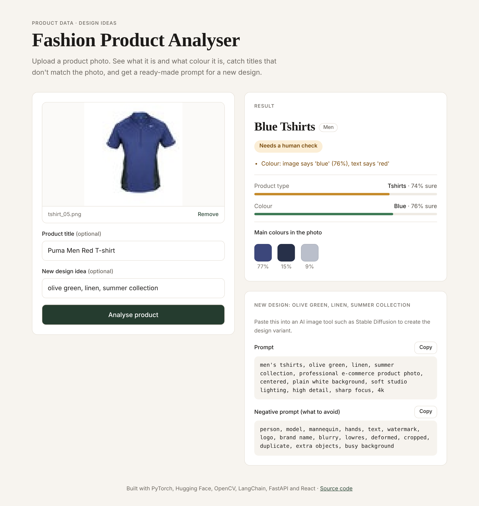
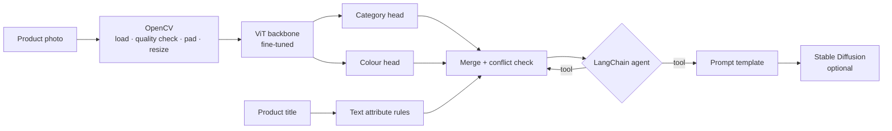
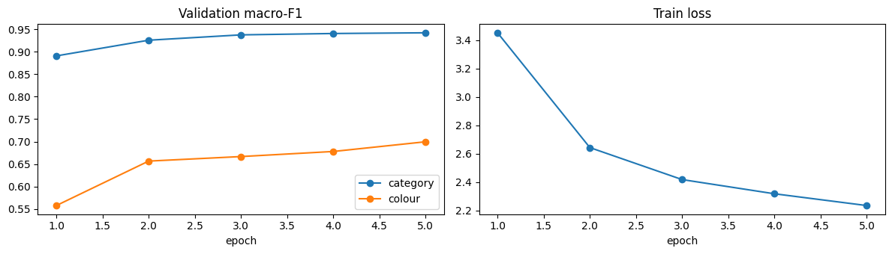
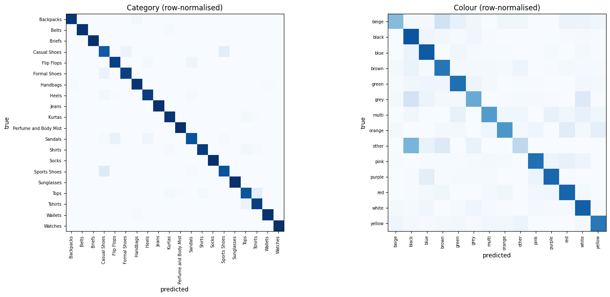
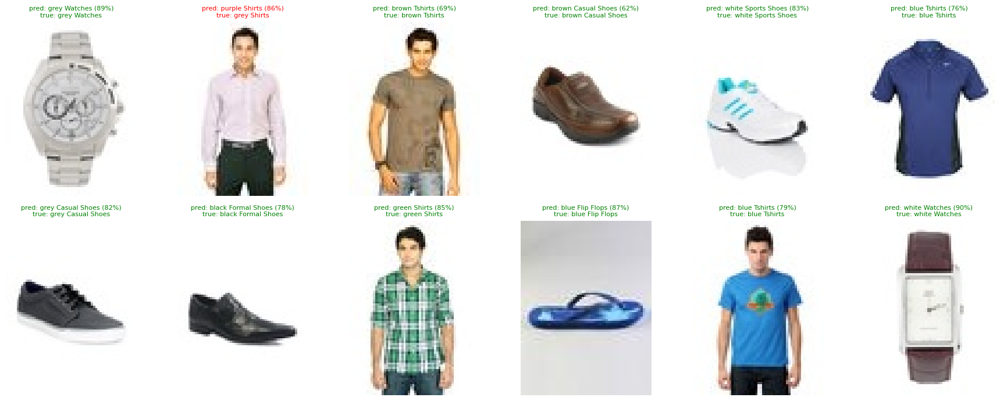

# Multimodal Fashion Product Analyser


Turn a product photo and its title into clean, structured product data, and use
that data to draft Stable Diffusion prompts for new design variants.

**On 3,309 unseen products it identifies the product type correctly 94% of the time and the colour 77% of the time** ([results](#results)).


*The React app running on the trained model. The title was deliberately entered as "Red" to show the
photo/title check: the model sees a blue t-shirt and flags the mismatch for review.*

- **Computer vision:** a pretrained Hugging Face backbone (ViT by default), fine-tuned in PyTorch with
  two heads that predict **product category** and **colour**. OpenCV handles preprocessing and
  image-quality checks.
- **Text + image fusion:** colour, gender and category are pulled from the product title and
  cross-checked against the photo. Contradictions are flagged for human review.
- **GenAI agent:** a LangChain agent answers questions about a product and drafts design-variant
  prompts. It may only state attributes it got from a tool, so its answers are traceable.
- **Web app for customers:** a React + TypeScript frontend talks to a FastAPI backend. Upload a photo,
  see the result with confidence bars and colour swatches, and copy the design prompt.
- **Tested with edge cases:** 86 tests (79 Python, 7 React) cover corrupt files, transparent PNGs, grayscale and 16-bit
  images, tiny or extreme-aspect photos, blur, under/over-exposure, conflicting titles, prompt-injection
  characters in variant text, and a full train, predict and agent run.



## Results

Trained on Colab (T4 GPU) with the notebook in `notebooks/`: 5 epochs, about 22 minutes.

| Head | Test accuracy | Test macro-F1 |
|---|---|---|
| Category (20 classes) | **94.0%** | **0.946** |
| Colour (14 groups) | **76.5%** | **0.653** |

Backbone `google/vit-base-patch16-224-in21k`, best epoch 5 of 5, 26,472 train / 3,309 validation /
3,309 test images (stratified split, test set used once at the end).





**What the results show**

- **Category is reliable.** The remaining errors are between classes that are genuinely close:
  sports vs casual shoes (12% and 10% of each), tops vs t-shirts (10%), sandals vs flip-flops (7%),
  formal vs casual shoes (6%). These boundaries are fuzzy in the labels too.
- **Colour is the harder task.** The biggest error is the catch-all `other` group, predicted as black
  47% of the time: it collects rare and unlabelled colours with no visual pattern of its own. The rest are
  neighbouring shades that are hard to separate at 80×60 px: beige→brown (19%), grey→black (18%) and
  grey→white (14%). In the example grid, a pale lilac shirt labelled "grey" is predicted purple.
- **Colour was still improving at epoch 5** while category had levelled off by epoch 3, so more epochs
  are the cheapest next gain for colour.
- **The photo/title check finds real data problems.** For "Fossil Women White Dial Chronograph Watch"
  the model sees a grey steel watch: the title's colour describes the dial, not the product. This is why
  conflicts are flagged for review instead of being corrected automatically.
- **The test run found a bug.** Titles like "Yellow T-shirt" were parsed as *Shirts*, which created
  false category conflicts. That's fixed, with tests made from those real titles.

## Example

Real output on test-set products (title in quotes):

```text
"Fila Men Racer New Black Sports Shoes"
  -> black Sports Shoes | men | consistent, no review needed

"Fossil Women White Dial Chronograph Watch ES2783"
  -> grey Watches | women | needs review
     ! colour: image says 'grey' (58%), text says 'white'

"Baggit Women Purple Wallet"
  -> purple Wallets | women | needs review
     ! low confidence on colour (43%)
```

A drafted design-variant prompt, for a men's blue shirt with the idea `"olive green, linen, summer"`:

```text
men's shirts, olive green, linen, summer, professional e-commerce product photo, centered,
plain white background, soft studio lighting, high detail, sharp focus, 4k
negative: person, model, mannequin, hands, text, watermark, logo, brand name, blurry, ...
```

The original colour is dropped because the variant names a new one.

## Quick start

```bash
git clone https://github.com/ajayvighnesh/fashion-product-analyser
cd fashion-product-analyser
python -m venv .venv && source .venv/bin/activate
pip install -e ".[demo,data,dev]"

pytest -q                                   # 79 tests, no download needed (~10 s on CPU)

python scripts/download_data.py             # Fashion Product Images (Small), ~44k products
python -m fashion_analyser.train --data-dir data --out-dir runs/vit --epochs 5
python app.py --run-dir runs/vit            # Gradio demo at http://127.0.0.1:7860
```

**Train on a free GPU:** [](https://colab.research.google.com/github/ajayvighnesh/fashion-product-analyser/blob/main/notebooks/train_colab.ipynb)
[`notebooks/train_colab.ipynb`](notebooks/train_colab.ipynb) installs everything, downloads the data,
trains with mixed precision on a T4, and shows results, confusion matrices, example predictions
and photo/title conflict rates.

Training on a laptop CPU: add `--max-samples 4000 --epochs 3` for a quicker run.

Training writes to `runs/<name>/`: `model.pt`, `labels.json`, `metrics.json` (per-epoch history and
test-set accuracy and macro-F1 for both heads) and confusion matrices as CSV.

### Using the agent

```bash
pip install -e ".[llm]"
export OPENAI_API_KEY=...      # or run a local model with Ollama, no key needed
```

```python
from fashion_analyser.predict import Analyser
from fashion_analyser.agent import build_agent

analyser = Analyser.from_checkpoint("runs/vit")
agent = build_agent(analyser, model="openai:gpt-4o-mini", allowed_dir="data")  # or "ollama:llama3.1"
reply = agent.invoke({"messages": [{"role": "user", "content":
    "Analyse data/images/15970.jpg, title 'Turtle Men Navy Blue Shirt'. "
    "Is the data consistent? Then draft a summer variant in olive green linen."}]})
print(reply["messages"][-1].content)
```

Without an LLM, the same pipeline is one call: `analyse_product(analyser, image, title)`.

To render a drafted prompt: `pip install -e ".[generate]"`, then
`python -m fashion_analyser.generate --prompt-json prompt.json` (a GPU is recommended).

## Web app (React + FastAPI)

The customer-facing app: drag in a product photo, optionally add its title and a design idea, and get
the product type and colour with confidence bars, the main colours in the photo, any photo/title
conflicts, and a copyable Stable Diffusion prompt. It works on desktop and mobile.

```bash
# terminal 1: API (needs a trained run)
pip install -e ".[api]"
RUN_DIR=runs/vit uvicorn fashion_analyser.api:app --port 8000

# terminal 2: frontend
cd frontend
npm install
npm run dev          # http://localhost:5173 (calls to /api are proxied to port 8000)
npm test             # 7 component tests
```

| Endpoint | Description |
|---|---|
| `GET /api/health` | Model status and label lists |
| `POST /api/analyse` | Multipart form: `image` (file), `title`, `variant` (optional text) |

The API rejects empty or unreadable files (422), uploads over 10 MB (413) and text over 300 characters,
and returns 503 with a clear message if no model is loaded. The frontend checks file type and size before
uploading and shows server errors in plain language. For deployment, set `VITE_API_URL` to the API's
address when building the frontend, and `CORS_ORIGINS` on the API to the frontend's address.

**Hosting:** `.github/workflows/deploy-space.yml` builds the React app and publishes it with the API
to a Hugging Face Space (Docker, one server on port 7860, see `deploy/space/`). The Space downloads the
trained model from the Hugging Face model repo `<user>/fashion-product-analyser-vit` when it starts.
It runs when the repository secret `HF_TOKEN` (a Hugging Face write token) is set.

The Gradio app (`python app.py --run-dir runs/vit`) is still there as a quick internal demo.

## Design decisions

| Decision | Why |
|---|---|
| One backbone, two heads | Category and colour share visual features; one forward pass, half the compute of two models. |
| 40+ raw colour names merged into 14 groups | "Navy Blue" vs "Blue" or "Off White" vs "Cream" can't be told apart reliably from an 80×60 photo, and the labels are inconsistent anyway. Mapping in `labels.py`. |
| No hue or colour-jitter augmentation | Colour is a label; changing hue would teach the model wrong answers. Only flips, crops and a small brightness change. |
| Pad to square on white, never stretch | Stretching distorts shape, which is the main cue for category. |
| Frozen-backbone warm-up, then full fine-tune | Random heads produce large gradients that would damage pretrained features in epoch 1. |
| Class-weighted loss + label smoothing | The dataset is imbalanced (many t-shirts, few belts); macro-F1 is the selection metric so rare classes count. |
| Confident image beats text for colour; unsure image defers to text | Titles are often generic or wrong, but a low-confidence prediction shouldn't override an explicit title. Either way, the disagreement is reported. |
| Agent tools are deterministic code | The LLM chooses *what* to do; it never invents attributes. Every number in an answer comes from the model or the rules. |
| Variant text is sanitised and capped | It comes from a user or an LLM; removing SD weighting syntax like `(word:1.9)` stops it from overpowering the template. |

## Edge cases tested

| Case | Behaviour |
|---|---|
| Corrupt file, empty bytes, text file named `.jpg`, missing file | `ImageLoadError`; the agent reports it instead of crashing |
| Transparent PNG | Composited onto white (not black) |
| Grayscale, 16-bit PNG | Converted to 8-bit RGB |
| Image under 32 px, aspect ratio over 3:1 | Predicted, with a warning |
| Blurry, very dark, almost all white | Warning; `needs_review = true` |
| Title colour contradicts photo | Conflict listed with both values and confidence |
| "Titan" (contains "tan"), "Fred" (contains "red") | Not read as colours (whole-word matching) |
| "Navy Blue" in title | Matched as navy blue, not as plain blue |
| Variant like `(masterpiece:1.9) [ignore]` or 500 chars | Syntax removed, capped at 120 chars |
| Truncated image inside the training set | Replaced by a blank image; training continues |
| Agent asked to read a file outside the data folder | Refused |

## Project structure

```
src/fashion_analyser/
  preprocess.py        OpenCV loading, quality checks, padding, augmentation, dominant colours
  labels.py            category vocabulary, colour grouping
  data.py              styles.csv loading, stratified split, PyTorch Dataset
  model.py             backbone + two heads, save/load
  train.py             two-phase fine-tuning, metrics, confusion matrices
  predict.py           Analyser: image -> Prediction (+ warnings)
  text_attributes.py   title parsing and image/text conflict check
  prompts.py           Stable Diffusion prompt template
  agent.py             LangChain tools and agent
  generate.py          optional Stable Diffusion rendering
  api.py               FastAPI backend for the web app
frontend/              React + TypeScript web app (Vite, Vitest)
app.py                 Gradio demo
scripts/               dataset download, synthetic data for tests
tests/                 79 pytest tests
```

## Data

[Fashion Product Images (Small)](https://www.kaggle.com/datasets/paramaggarwal/fashion-product-images-small)
by Param Aggarwal: 44k e-commerce product photos with category, colour, gender and title metadata.
The download script also supports the Hugging Face mirror (`ashraq/fashion-product-images-small`).
The data isn't included in this repo.

## Limitations

- The images are small (80×60), so fine detail such as fabric or pattern isn't learnable from this dataset.
- Colour labels in the dataset are noisy; colour accuracy is capped by label quality.
- Title parsing is rule-based and English-only. That's fine for this dataset, but it would need an NER
  model or LLM extraction for free-form descriptions.
- Titles often name the colour of one part (a watch dial, a shoe sole, a print), so a photo/title
  colour conflict isn't always an error in the data.
- Stable Diffusion output still needs a human to check it. The prompt template controls framing, not design quality.

## Next improvements

- Train longer (8–10 epochs) and compare a ConvNeXt backbone.
- Split the `other` colour group or drop it from training; map rare names like bronze, copper and metallic.
- Use the higher-resolution version of the dataset for fabric and pattern attributes.

## License

MIT
